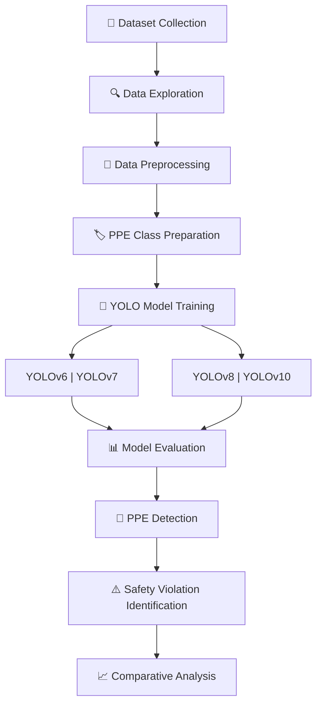

<div align="center">

# 🦺 Real-Time PPE & Safety Violation Detection
### In Industrial Environments Using Deep Learning

<p>
  
  
  
  
</p>

**Making Industrial Workplaces Safer Through Intelligent Computer Vision**

An AI-powered computer vision project focused on detecting Personal Protective Equipment (PPE) and identifying safety compliance violations in industrial environments using deep learning and YOLO-based object detection models.

</div>

---

## 📌 Project Overview

Workplace safety is a critical concern in industrial environments, where the absence of appropriate Personal Protective Equipment (PPE) can expose workers to serious occupational hazards.

This project explores the application of **deep learning and real-time object detection** to automate PPE monitoring and identify potential safety violations through industrial CCTV and video data.

The project involves a comparative study of four YOLO architectures:

- YOLOv6
- YOLOv7
- YOLOv8
- YOLOv10

The objective is to investigate their effectiveness in detecting protective equipment, identifying missing safety gear, and supporting automated industrial safety monitoring.

## 🎯 Project Objectives

- Develop an automated PPE detection approach using deep learning.
- Detect safety equipment such as helmets, safety vests, gloves, goggles, and boots.
- Identify missing PPE and potential safety compliance violations.
- Compare different YOLO architectures for object detection.
- Explore the application of computer vision in industrial safety monitoring.
- Evaluate model performance to understand detection effectiveness.

---

## 🔍 Detection Categories

The project explores a 10-class PPE detection setup.

| Category | Description |
|---|---|
| Helmet | Worker wearing a helmet |
| No Helmet | Missing helmet |
| Vest | Worker wearing a safety vest |
| No Vest | Missing safety vest |
| Gloves | Protective gloves detected |
| No Gloves | Missing protective gloves |
| Goggles | Protective goggles detected |
| No Goggles | Missing protective goggles |
| Boots | Protective boots detected |
| No Boots | Missing protective boots |

These categories help distinguish between PPE compliance and potential safety violations.

---

## 🧠 Model Comparison

One of the major components of this project is the comparative evaluation of different YOLO architectures.

<div align="center">

| Model | Architecture | Focus |
|:---:|:---:|---|
| YOLOv6 | Object Detection | PPE Detection |
| YOLOv7 | Object Detection | PPE Detection |
| YOLOv8 | Object Detection | PPE Detection |
| YOLOv10 | Object Detection | PPE Detection |

</div>

**Comparative analysis focuses on:**

- Object detection performance
- Precision and recall
- Detection accuracy
- Model evaluation
- Practical applicability to industrial safety monitoring

The objective is to understand the strengths and limitations of different YOLO versions rather than assume that one architecture performs best in every scenario.

---

## ⚙️ Project Workflow

<div align="center">



</div>

### Workflow Explanation

1. **Dataset Preparation:** Prepare the PPE detection dataset for model development.
2. **Data Preprocessing:** Organise and prepare images and annotations.
3. **Class Configuration:** Configure the required PPE detection categories.
4. **Model Development:** Train and experiment with different YOLO architectures.
5. **Model Evaluation:** Analyse the detection performance using evaluation metrics.
6. **Safety Analysis:** Examine detected PPE and missing equipment.
7. **Comparative Study:** Compare the investigated architectures.

---

## 🛠️ Technology Stack

<p align="center">
  
  
  
  
  
  
  
  
</p>

**Core Technologies:**

- Python
- Deep Learning
- Convolutional Neural Networks (CNN)
- YOLO Object Detection
- Computer Vision
- Image Processing
- Google Colab

---

## 📁 Repository Structure

```text
Real-Time-PPE-and-Safety-Violation-Detection/
│
├── Literature survey/
│   └── Research papers and literature review
│
├── Project/
│   └── Project resources and implementation files
│
├── PPE_Safety_Detection_Combined_Execution_Order.ipynb
│
├── PPE_Safety_Detection_Complete_Research_Flow.ipynb
│
├── PPE_YOLOv6_v7_v8_v10_all_splits.ipynb
│
├── PPE_compliance_helmet_vest.ipynb
│
├── PPE_Safety_Detection_Methodology.drawio
│
├── PPE_Safety_Detection_Methodology.drawio.png
│
├── Research Reports/
│
└── README.md
```

---

## 📊 Model Evaluation

The project investigates the performance of multiple YOLO architectures to understand their suitability for PPE detection.

Evaluation considers:

| Metric | Purpose |
|---|---|
| Precision | Measures the proportion of correct positive detections |
| Recall | Measures the proportion of actual objects detected |
| F1-Score | Balances precision and recall |
| mAP | Evaluates object detection performance |
| Inference Speed | Examines detection efficiency |

Actual evaluation results should be taken from the completed model experiments and notebooks.

---

## 💡 Key Project Contributions

This project was developed as a collaborative research and implementation effort involving a team of two.

My contributions focused on:

- Working on helmet and safety vest detection.
- Exploring PPE compliance and safety violation identification.
- Implementing and analysing detection workflows.
- Participating in comparative evaluation of YOLO architectures.
- Contributing to the overall research and project methodology.

---

## 🚀 Applications

The proposed approach has potential applications in:

- 🏭 Industrial workplace safety monitoring
- 🦺 Automated PPE compliance checking
- 🏗️ Construction site surveillance
- 🏢 Manufacturing facility monitoring
- ⚠️ Identification of missing protective equipment
- 📹 CCTV-based safety monitoring systems

---

## 🔮 Future Enhancements

- Integrate real-time CCTV monitoring.
- Develop automated safety violation alerts.
- Improve detection performance in challenging lighting conditions.
- Explore edge-device deployment.
- Introduce worker-level PPE compliance tracking.
- Develop a dashboard for industrial safety monitoring.
- Investigate detection speed and deployment efficiency.

---

## ▶️ Getting Started

### Requirements

- Python
- Google Colab
- Required YOLO framework dependencies
- Compatible PPE dataset
- GPU-enabled runtime recommended for model training

### Running the Project

1. Clone this repository:

```bash
git clone https://github.com/AnkithR10/Real-Time-PPE-and-Safety-Violation-Detection-in-Industrial-Environments-Using-Deep-Learning.git
```

2. Open the required `.ipynb` notebook in Google Colab.

3. Configure the dataset paths and required dependencies.

4. Follow the notebook execution order.

5. Run the model training, evaluation, and detection experiments.

**Note:** Dataset files and trained weights may need to be provided separately, depending on their availability and size.

---

## 👨‍💻 Project Information

**Project Title:** Real-Time PPE and Safety Violation Detection in Industrial Environments Using Deep Learning

**Team Size:** 2 Members

**Platform:** Google Colab

**Domain:** Artificial Intelligence | Deep Learning | Computer Vision

**Primary Focus:** Helmet Detection, Safety Vest Detection, and PPE Compliance

**Models Investigated:** YOLOv6, YOLOv7, YOLOv8, YOLOv10

**Developer:** Ankith R

**GitHub:** [AnkithR10](https://github.com/AnkithR10)

---

## 🤝 Contributions

Contributions, suggestions, and feedback are welcome!

If you find this project interesting, consider giving the repository a ⭐.

---

<div align="center">

### 🦺 Safer Workplaces. Smarter Monitoring. Intelligent AI.

**Using Deep Learning to Move Towards Safer Industrial Environments.**

[](https://github.com/AnkithR10)

</div>
